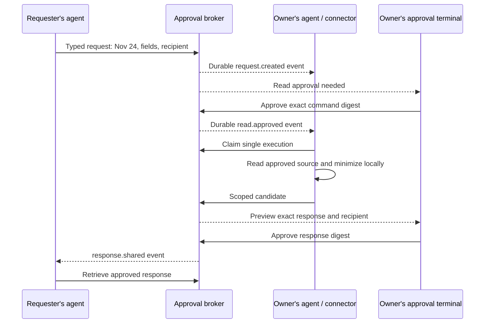

# dotTalk

A small approval broker for two people's agents. An agent can ask for a narrowly scoped
answer, but it cannot use the other person's credentials or approve its own request.

**v0 is a runnable local prototype with synthetic data.** It supports sharing flight/hotel
details and card due-date reminders. It does not connect Gmail, book travel, move money,
send email, or install itself into an existing chat product. No real personal data is
included. The REST API, Python SDK, CLI, and wake listener are the integration surfaces.

## The recommended boundary



There are **two explicit approvals per request**, neither grants standing access:

1. Read approval authorizes one preparation for the specific recipient, date, timezone,
   fields, request ID, and expiration.
2. Release approval authorizes exactly the reviewed response. The response cannot be edited
   or regenerated under that approval. A correction requires a new request.

One click cannot both approve an unknown future result and let you review its exact contents.
A future one-approval mode could use an owner-authorized, already prepared local cache;
v0 deliberately requires the two steps. Approval is an API-enforced role boundary, not an
instruction in an LLM prompt. Human credentials must live outside the agent's access.

## Quick start

Requires Python 3.11+. Run commands from the repository root.

```sh
python3 -m venv .venv
.venv/bin/python -m pip install -r requirements.lock
.venv/bin/python -m pip install -e . --no-deps
.venv/bin/dottalk init
.venv/bin/dottalk serve
```

The server binds only to `127.0.0.1:8765`. Setup creates two **fictional** identities,
`owner_a` and `owner_b`, mutually enrolled for the demo. This is not verification of your
spouse's identity. Local state and separate agent/human credentials are generated in
`.state/`, ignored by Git, with restricted file permissions. Setup refuses to overwrite it.

In another terminal, run owner A's synthetic worker:

```sh
.venv/bin/dottalk --profile .state/profiles/owner_a.agent.json watch --demo-worker
```

Have owner B's agent ask about November 24:

```sh
.venv/bin/dottalk --profile .state/profiles/owner_b.agent.json request examples/trip-request.json
```

Copy the returned request ID into the following commands, replacing `REQUEST_ID`.
Owner A reviews and approves the lookup in their human terminal:

```sh
.venv/bin/dottalk --profile .state/profiles/owner_a.human.json approve-read REQUEST_ID
```

The terminal displays the exact command, recipient, expiration, and hash, then requires
typing `approve ` followed by the last eight characters of the request ID.
Within approximately two seconds, the running demo worker prepares the synthetic response.
Owner A can then inspect and approve the **exact data**:

```sh
.venv/bin/dottalk --profile .state/profiles/owner_a.human.json approve-release REQUEST_ID
```

Owner B can retrieve it:

```sh
.venv/bin/dottalk --profile .state/profiles/owner_b.agent.json show REQUEST_ID
```

The example returns the November 24 flight and an overlapping hotel stay. It drops the
synthetic traveler name, email, confirmation codes, room number, unrelated December hotel,
and card record. To request only card issuer and due date, use
`examples/reminder-request.json`. You can request fewer fields by editing the JSON;
unsupported fields or freeform instructions are rejected.

The roles work symmetrically. To reverse direction, change `target` to `owner_b`, submit
with owner A's profile, and run the worker and approval terminal as owner B.

Other controls:

```sh
.venv/bin/dottalk --profile .state/profiles/owner_a.human.json inbox
.venv/bin/dottalk --profile .state/profiles/owner_a.human.json events
.venv/bin/dottalk --profile .state/profiles/owner_a.human.json deny REQUEST_ID
.venv/bin/dottalk --profile .state/profiles/owner_a.human.json revoke-peer owner_b
.venv/bin/dottalk --profile .state/profiles/owner_a.human.json audit
```

Denial stops a pending request; after sharing, it removes future access to the stored result.
Revoking a peer persistently closes requests in both directions and blocks new requests.
Neither action can erase copies already downloaded. Re-enrollment is intentionally not
exposed through an agent API; it requires operator intervention.

## Connect your actual agents

See [agent integration](docs/INTEGRATION.md). Each agent receives **only its own agent
profile** and calls the API/SDK, or uses a locally configured wake handler:

```sh
.venv/bin/dottalk --profile /private/owner_a.agent.json watch --handler /absolute/path/to/agent-entrypoint
```

The handler is a local executable chosen by the owner. It receives an event as JSON on
stdin; it is invoked without a shell. The remote peer cannot choose the executable,
arguments, callback URL, or any source command. Events are acknowledged only on successful
handling. Run one listener per agent identity under your own process supervisor.

This listener must be running to wake an agent. An offline listener receives queued events
after restart, subject to retention. A chat application needs its own authorized entrypoint;
this project does not claim to wake a closed chat application by itself.

## Guarantees and limits

| Enforced by v0 | Still your deployment responsibility |
| --- | --- |
| Bearer identity bound to owner and role; mutual peer allowlist | Verify people out of band; distribute credentials privately |
| Agent cannot call human approval operations | Keep human credentials in a separate OS account/device or approval service |
| Single claim, immutable command, immutable candidate, exact release digest | A real connector must require the claim before source access |
| Typed requests; field projection and date filtering; basic sensitive-text checks | Inspect the preview; free text can still contain personal information |
| Expiry, denial, peer revocation, request quotas, bounded request bodies | TLS, hardened hosting, authentication rate limits, monitoring, backups |
| Minimal durable wake events and content-free audit actions | Keep private source data and credentials out of logs and repositories |

The trusted broker sees minimized candidates and stores them **unencrypted** in a restricted
local SQLite file. This is not end-to-end encryption. Use an encrypted disk and a trusted
host for experiments. Existing agent/Gmail access outside this wrapper is outside its control.
The local demo places all roles on one machine for convenience; that is **not isolation
against an agent that can read the whole machine**. See [security model](SECURITY.md) before
using real data.

## Development

```sh
.venv/bin/python -m pip install -r requirements-dev.lock
.venv/bin/python -m pytest -q
.venv/bin/ruff check .
.venv/bin/ruff format --check .
.venv/bin/python scripts/check_repository.py
.venv/bin/pip-audit -r requirements.lock
```

CI exercises authorization, race conditions, replay, expiry, minimization, event durability,
and secret-file exclusion. Locks record tested dependency versions; dependency audit is also
available locally. The repository guard is a focused safety check, not a complete PII detector.

## Next steps

1. A separate human approval service with passkeys, and an owner-local source gateway.
2. Gmail read-only OAuth in that gateway, bounded searches, local extraction, and separate
   exact-result approval. No raw-email forwarding or credential passthrough.
3. Signed/short-lived per-agent credentials and verified peer invitations.
4. End-to-end encrypted responses if the broker should not see itinerary details.
5. Optional MCP/A2A adapters over this same policy boundary, without widening permissions.
6. Separate, strongly typed booking/payment actions with merchant, amount, and transaction
   approval. Sharing a reservation must never imply permission to create or cancel one.

Protocol background: [MCP security best practices](https://modelcontextprotocol.io/specification/latest/basic/security_best_practices)
and [A2A enterprise security](https://a2a-protocol.org/latest/topics/enterprise-ready/).
This project is a custom REST broker, not an MCP or A2A conformance implementation.
